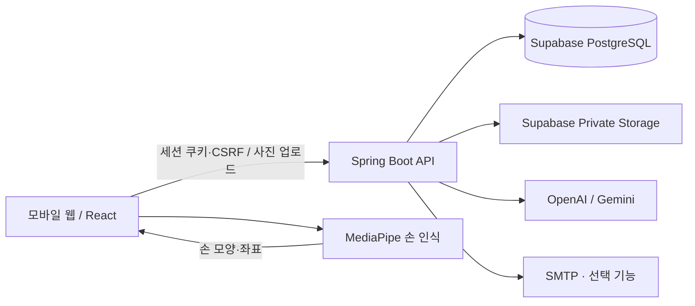

# TRUEKET · 트루켓 Backend

**표값을 보내기 전, 거래 대화의 위험 신호와 판매자의 티켓 보유 화면을 확인하는 모바일 웹 서비스입니다.**

트루켓은 팬 간 티켓 거래에서 대화 캡처 판독, 신고 이력 조회, 트루샷 촬영 미션을 제공합니다. 이 저장소는 인증·계정, 판독, 신고·증빙·이의제기, 트루샷 API를 담당하는 Spring Boot 백엔드입니다.

> AI는 대화의 근거를 추출하고, 최종 위험 단계는 서버 규칙으로 계산합니다. 위험 신호가 없거나 트루샷 미션을 통과했더라도 거래 안전·티켓 진위·입장을 보장하지 않습니다.

[Frontend 저장소](https://github.com/TRUEKET/Front) · [Backend 저장소](https://github.com/TRUEKET/Back) · [시연 안내](docs/demo-guide.md) · [테스트 실행 안내](docs/testing.md)

백엔드 배포 url : https://13.124.146.122.sslip.io

## 주요 기능

| 기능 | 구현 내용 |
| --- | --- |
| 인증·계정 | 이메일·비밀번호 가입/로그인, 서버 세션·CSRF, 시연용 휴대폰 인증, 계정 조회, 번호·비밀번호 변경, 로그아웃·탈퇴 |
| 거래 대화 판독 | 캡처에서 거래 유형·식별자·판매자 발화·위험 근거 추출, 신호 사전 기반 서버 판정, 신고 집계 결합, 사진별 근거·재시도·피드백 |
| 신고 조회 | 정규화·해시 기반 식별자 조회, 공개 신고 상세·타임라인·연관 정보 조회 |
| 신고·증빙 | 의심/사기 신고, 송금 사진 수취 계좌 검증, 가린 증빙 저장, 본인 신고 목록·상세·삭제 |
| 이의제기 | 이의제기 접수, 증빙 및 응답 처리, 신고 상태·공개 여부 반영, 선택적 이메일 발송 |
| 트루샷 | 구매자 요청·판매자 링크, 동의·1/2차 촬영, 인증코드·예매 화면 확인, MediaPipe 결과와 미션 비교, 가림·공유·만료 처리 |

### 판독 처리 방식

1. 대화 캡처와 선택 입력을 받아 이미지·요청 형식을 검증합니다.
2. 선택한 LLM API가 구조화된 식별자와 위험 신호 후보·인용 근거를 추출합니다.
3. 서버가 활성 신호, 화자, 인용문과 원문 일치 여부를 검증합니다. 공백·허용 문장부호 차이는 보정하되 존재하지 않는 근거는 인정하지 않습니다.
4. 서버 규칙으로 대화 위험 단계를 계산하고 공개 신고 집계를 결합합니다.
5. 마스킹된 식별자, 근거, 결과 제목·한계 안내와 신고 가능 조건을 반환합니다.

신호 사전 v0.2의 정의·예시·반례를 사용해 예시와 다른 표현도 문맥으로 판단하도록 안내합니다. S-C1은 예매내역 확인을 미루면서 결정·입금을 먼저 요구하는 경우를 포함합니다. 상세 정책은 [판독 규칙](docs/analysis-rules.md)과 [판독 API](docs/analyze-api.md)를 참고하세요.

## 기술 구성

| 구분 | 기술 |
| --- | --- |
| 언어·프레임워크 | Java 17, Spring Boot 4.0.9, Spring MVC |
| 인증·영속성 | Spring Security, 서버 세션, Spring Data JPA, PostgreSQL |
| 데이터·파일 | Supabase PostgreSQL, Supabase Private Storage |
| AI 연동 | 대화 판독: OpenAI 또는 Gemini 선택 / 트루샷: OpenAI 및 프론트 MediaPipe 결과 연동 |
| 문서·테스트 | springdoc OpenAPI 3.0.0, JUnit 5, MockMvc, H2, Embedded PostgreSQL |
| 빌드·배포 | Gradle Wrapper, GitHub Actions, Docker, AWS ECR·EC2·SSM |



손 인식 결과는 프론트에서 전달하며 서버가 저장된 미션과 비교합니다. MediaPipe 실행 코드는 이 백엔드 저장소의 실행 대상이 아닙니다.

## 디렉터리 구조

```text
src/main/java/com/trueket/backend
├── global       # 설정, 공통 예외·응답, 보안
├── user         # 인증·계정·휴대폰 인증·탈퇴
├── analyze      # 대화 판독·AI 호출·서버 위험 판정
├── feedback     # 판독 피드백
├── identifier   # 식별자 정규화·해시·암호화·마스킹
├── lookup       # 기존 신고 검색
├── report       # 신고·증빙·본인 신고
├── dispute      # 이의제기
└── trueshot     # 촬영 요청·미션·판정·공유·만료
src/main/resources
├── analysis     # 신호 사전·프롬프트·응답 스키마
└── db           # 기능별 수동 스키마 변경 SQL
```

기능별로 controller/service/repository/entity/dto 등을 분리합니다. 엔티티의 기본 식별자 필드명은 `id`를 사용합니다.

## 로컬 실행

### 1. 준비

- JDK 17과 PostgreSQL 접속 정보가 필요합니다. Gradle은 저장소의 Wrapper를 사용합니다.
- 전체 기능 실행에는 팀 DB 스키마, AI API 키와 Private Storage 설정이 필요합니다.
- `spring.jpa.hibernate.ddl-auto=validate`이므로 앱이 테이블을 자동 생성하지 않습니다. `src/main/resources/db/`는 기능별 변경 SQL이며 **빈 DB를 완성하는 일괄 설치 스크립트가 아닙니다.** 팀의 기준 스키마와 기존 적용 이력을 확인한 후 필요한 변경만 적용하세요.

```bash
git clone https://github.com/TRUEKET/Back.git
cd Back
```

`main`은 배포 기준, `develop`은 개발 통합 기준입니다.

### 2. 환경변수 설정

IntelliJ의 **실행 → 구성 편집 → BackendApplication → 환경 변수** 또는 실행할 셸에 등록합니다. `.env` 파일을 만드는 것만으로 Spring Boot가 자동으로 읽지는 않습니다.

| 환경변수 | 용도 |
| --- | --- |
| `DB_HOST`, `DB_PORT`, `DB_NAME` | PostgreSQL 접속 주소·포트·DB명 |
| `DB_USERNAME`, `DB_PASSWORD` | DB 계정·비밀번호 |
| `PHONE_ENCRYPTION_KEY`, `PHONE_HASH_KEY` | 전화번호 암호화·해시용 각각의 Base64 키 |
| `IDENTIFIER_ENCRYPTION_KEY` | 신고 식별자 암호화용 Base64 키 |
| `IDENTIFIER_HASH_SECRET` | 동일 식별자 조회에 사용하는 해시 비밀값 |
| `AI_PROVIDER` | `openai` 또는 `gemini` |
| `OPENAI_API_KEY`, `OPENAI_MODEL` | OpenAI 사용 시 설정. 트루샷 AI에도 사용 |
| `GEMINI_API_KEY`, `GEMINI_MODEL` | Gemini 판독 사용 시 설정 |
| `SUPABASE_URL`, `SUPABASE_SERVICE_ROLE_KEY` | 서버 전용 Storage 접속 설정 |
| `SPRING_PROFILES_ACTIVE` | 로컬 시연은 `demo` |
| `SESSION_COOKIE_SECURE` | 로컬 HTTP에서만 `false`, HTTPS에서는 `true` |

팀 DB를 공유한다면 암호화·해시 키도 기존 데이터와 일치해야 합니다. 임의 교체하면 복호화·동일 식별자 조회가 실패할 수 있습니다. 실제 비밀번호·API 키·서비스 역할 키는 Git에 커밋하거나 프론트에 전달하지 않습니다.

Storage 기본 버킷은 `report-evidence`, `trueshot-photos`이며 둘 다 Private입니다. DB에는 전체 공개 URL 대신 버킷 내부 파일 키를 저장합니다. 메일은 기본 비활성화이며, 필요한 경우 `DISPUTE_MAIL_ENABLED`, `MAIL_HOST`, `MAIL_PORT`, `MAIL_USERNAME`, `MAIL_PASSWORD`, `MAIL_FROM`, `DISPUTE_SUPPORT_EMAIL`을 설정합니다. 상세 옵션은 [인증 문서](docs/auth-api.md), [트루샷 설정](docs/trueshot-ai-cv.md)을 참고하세요.

### 3. 실행

환경변수 등록 후 프로젝트 루트에서 실행합니다.

```bash
bash gradlew bootRun
```

기본 API 주소는 `http://localhost:8080`입니다. IntelliJ에서는 `BackendApplication`을 실행해도 됩니다.

## API 문서와 연동

- 로컬 Swagger UI: `http://localhost:8080/swagger-ui/index.html`
- OpenAPI: `/v3/api-docs/accounts`, `/v3/api-docs/analysis`
- JWT 대신 **서버 세션 쿠키**를 사용합니다. 먼저 `GET /auth/csrf`로 토큰을 받고 변경 요청의 `X-CSRF-TOKEN` 헤더에 넣습니다. 가입·로그인·로그아웃 후에는 새 토큰을 받습니다.
- 브라우저 연동은 쿠키를 포함해야 하며, 별도 출처 구성에서는 서버 CORS와 HTTPS·쿠키 정책을 함께 맞춰야 합니다.
- 운영 시의 `prod` 프로필에서는 Swagger가 기본 비활성입니다. 필요할 때 서버 설정의 `SWAGGER_ENABLED=true`로 활성화합니다.

| 영역 | 상세 문서 |
| --- | --- |
| 인증·계정·탈퇴 | [인증 API](docs/auth-api.md) |
| 판독·피드백 | [판독 API](docs/analyze-api.md) |
| 공개 조회 | [신고 조회 API](docs/lookup-api.md) |
| 신고·송금 증빙 | [신고 API](docs/report-api.md), [증빙 API](docs/report-evidence-api.md) |
| 본인 신고 | [내 신고 API](docs/my-reports-api.md) |
| 이의제기 | [이의제기 API](docs/dispute-api.md) |
| 트루샷 | [요청·촬영 API](docs/trueshot-api.md), [판정·공유 API](docs/trueshot-finalization-api.md), [손 인식 연동](docs/hand-analyze-api.md) |

공개 조회와 판독 식별자는 마스킹합니다. 본인 신고는 세션 소유권 확인 후 `identifiers[].value`로 전체값을 제공하며, `maskedValue`는 호환용 마스킹 필드입니다. 판독 화면에는 `resultTitle`과 `limitationNotice`를 연결합니다.

## 시연 범위와 확인 방법

**실제 SMS 발송은 구현 범위에서 제외하고, 인증 로직은 서버에서 처리합니다.**

문자 비용·발신번호 등록 제약으로 `demo` 프로필에서 발송을 모의 처리합니다. 서버가 매번 무작위 6자리 코드를 생성하며 해시 저장, 3분 만료, 60초 재발급 제한, 오입력 5회 제한, 세션 연결 및 가입 시 인증 소비를 처리합니다. 발송 응답의 `demoSms.code`로 이번 코드를 확인합니다. 고정 코드 방식이 아니며 실제 휴대폰 소유 여부를 증명하지는 않습니다.

- `demo` 프로필에서 `/auth/demo`로 인증 확인용 화면을 열 수 있습니다.
- 전체 흐름은 **휴대폰 인증 → 가입/로그인 → 캡처 판독 → 송금 증빙 검증 → FRAUD 신고 → 본인 신고 조회** 순서로 확인할 수 있습니다.
- 단계별 요청 예시·CSRF·쿠키 설정은 [시연 안내](docs/demo-guide.md)를 참고하세요. 문서 예시 계정은 실제 공용 로그인 계정이 아닙니다.
- AI 판독은 이미지 품질·대화 맥락·외부 API 상태에 영향을 받습니다. 합성 사례 통과가 모든 실사용 캡처의 정확도를 보장하지 않습니다.
- 실제 AI 호출에는 공급자의 사용 한도·요금 정책이 적용됩니다. 자동 테스트와 외부 API 실호출 검증은 구분합니다.

## 테스트와 검증 기록

```bash
# 전체 자동 테스트
bash gradlew test

# 테스트 및 실행 JAR 빌드
bash gradlew clean build
```

테스트는 H2와 일회용 Embedded PostgreSQL을 사용합니다. 별도 Supabase 테스트 프로젝트·Docker·`TEST_DB_*` 설정은 필요 없습니다. 최초 라이브러리·바이너리 다운로드에는 인터넷이 필요하고, PostgreSQL 프로세스를 실행할 수 있는 일반 사용자 환경이 필요합니다.

결과 보고서: `build/reports/tests/test/index.html`

- [테스트 환경과 외부 서비스 대체 범위](docs/testing.md)
- [인증·판독 실패 상황 점검](docs/failure-checks.md)
- [실제 AI·DB·Storage 연동 검증 기록](docs/real-api-verification.md)
- [실제 AI 표현 변형·정상 대화 4건 점검](docs/analysis-live-quality-check.md)

## 배포와 역할 분담

`develop`은 개발 통합 브랜치이며 `main` 반영 시 GitHub Actions가 빌드·테스트 → Docker 이미지 생성 → AWS ECR 업로드 → SSM을 통한 EC2 배포를 실행합니다. AWS 설정과 비밀값은 GitHub 환경/서버에서 관리합니다.

| 담당 영역 | 범위 |
| --- | --- |
| 그 외 기능 | 인증·계정·대화 판독·피드백·공통 AI API 설정 |
| 신고 기능 | 신고 조회·등록·증빙·이의제기 |
| 트루샷 기능 | 요청·판매자 촬영·판정 연결·가림·공유·만료 |
| 공동 작업 | 트루샷 AI·CV 및 기능 간 연동 검증 |
